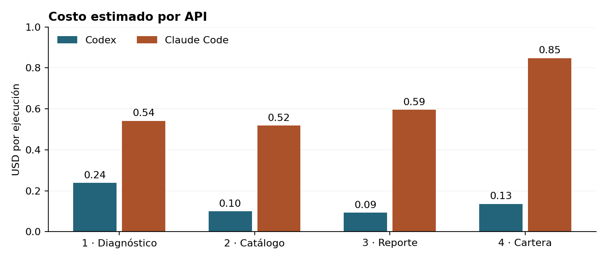

# Agent Harness Lab

Ejercicios reproducibles para comparar cómo Claude Code y Codex investigan
un fallo en TypeScript y PostgreSQL. Cada ronda comparte un punto de partida y
un prompt entre los participantes. Los resultados corresponden a estas ejecuciones.

## Cuatro rondas de un vistazo

| Ronda · tarea | Codex · resultado | Tiempo | Claude Code · resultado | Tiempo |
|---|---|---:|---|---:|
| 1 · Diagnosticar un duplicado | Identificó el duplicado en los datos de prueba | ≈1:04 | Llegó al mismo diagnóstico | ≈1:10 |
| 2 · Importar un catálogo | Pasó la prueba original y la posterior con duplicados previos | ≈1:27 | Pasó la original y falló con duplicados previos | ≈1:07 |
| 3 · Asignar facturas al mes local | 7/7 · parche idéntico | 0:59 | 7/7 · parche idéntico | 1:36 |
| 4 · Reconstruir saldos históricos | 9/9 · una consulta por reporte | 1:57 | 9/9 · una consulta por reporte | 8:08 |

Tiempos en minutos y segundos, una ejecución por agente y ronda. El signo ≈ indica
una duración reconstruida del registro local, desde el inicio del turno (Codex)
o el mensaje del usuario (Claude Code) hasta la respuesta final. En las rondas
3 y 4 se usó el cronómetro del operador. Codex usó GPT-6.2 Astra Medium en la
ronda 1 y GPT-6.2 Sol High en las demás. Claude Code usó Opus 5.5 en las cuatro
rondas, con esfuerzo High en las rondas 2 a 4.

<details>
<summary>Consumo de tokens de las ocho ejecuciones</summary>

| Ronda | Codex · total | De caché leída | De salida | Claude Code · total | De caché leída | De salida |
|---|---:|---:|---:|---:|---:|---:|
| 1 | 216 662 | 199 296 | 594 | 645 126 | 596 759 | 2 878 |
| 2 | 298 065 | 271 360 | 2 273 | 752 618 | 710 489 | 3 270 |
| 3 | 272 761 | 242 816 | 996 | 873 233 | 825 729 | 4 143 |
| 4 | 444 184 | 410 752 | 3 363 | 1 039 434 | 972 063 | 9 579 |

El total incluye entrada y salida de todas las llamadas registradas en la
ejecución. Las columnas de caché leída y salida ya están incluidas en el total.
En Codex se tomó el último contador acumulado. En Claude Code se contó una vez
cada mensaje de modelo por ID y se sumaron entrada, creación y lectura de caché
y salida. Una misma porción de contexto puede contabilizarse en varias llamadas.
Cada herramienta usa su propio contexto y tokenizador. El costo facturado queda
fuera de estas mediciones.

</details>

## Costo estimado por API



| Ronda | Codex (USD) | Claude Code (USD) |
|---|---:|---:|
| 1 | 0.238 | 0.541 |
| 2 | 0.099 | 0.518 |
| 3 | 0.092 | 0.595 |
| 4 | 0.135 | 0.848 |
| **Total** | **0.563** | **2.502** |

Estimación del costo de tokens si las ocho ejecuciones hubieran usado las APIs directas
con tarifas estándar del 24 de noviembre de 2026 y el mismo uso de caché observado.
Cada celda y el total se redondean por separado. La facturación real, suscripciones,
herramientas, impuestos y descuentos quedan fuera del cálculo.

<details>
<summary>Tarifas y cálculo reproducible</summary>

Precios en USD por millón de tokens, en orden de entrada ordinaria, escritura de
caché utilizada, lectura de caché y salida.

| Modelo | Entrada | Escritura | Lectura | Salida |
|---|---:|---:|---:|---:|
| GPT-6.2 Astra (ronda 1) | 8 | Sin uso | 0.40 | 40 |
| GPT-6.2 Sol (rondas 2–4) | 2 | Sin uso | 0.10 | 10 |
| Claude Opus 5.5 (rondas 1–4) | 4 | 8 (1 hora) | 0.20 | 20 |

Cada categoría se multiplica por su tarifa y la suma se divide entre un millón.
Para Codex se resta la lectura de caché de la entrada total. Los registros indican
cero tokens de escritura y un máximo de 46 075 tokens de entrada por solicitud,
dentro del tramo de contexto corto. La salida ya incluye el razonamiento.

Para Claude, las escrituras de una hora fueron 45 473, 38 843, 43 343 y 57 772
tokens en las rondas 1 a 4, respectivamente. La entrada ordinaria fue de 16, 16,
18 y 20 tokens. Todas las escrituras registradas tuvieron duración de una hora.
La tabla de consumo de arriba contiene las lecturas de caché y la salida de ambos agentes.

[Tarifas oficiales de OpenAI](https://developers.openai.com/api/docs/pricing) · [Tarifas oficiales de Claude Opus 5.5](https://platform.claude.com/docs/en/models/opus-5-5/whats-new-opus-5-5)

</details>

## Ronda 4 · Conciliación histórica de cartera

El reporte reconstruye los saldos de facturas a una fecha de corte con anticipos,
pagos parciales y reversiones. Ambos agentes comenzaron en `1d3a3ab` con los
mismos [nueve casos y criterios de evaluación](round-4/README.md).

| Herramienta y modelo | Casos aprobados | Tiempo de entrega (min:s) | Parche |
|---|---:|---:|---|
| Codex · GPT-6.2 Sol High | 9/9 | 1:57 | [5f161e5](https://github.com/PaoloDuenas/agent-harness-lab/commit/5f161e5) |
| Claude Code · Claude Opus 5.5 High | 9/9 | 8:08 | [92e203c](https://github.com/PaoloDuenas/agent-harness-lab/commit/92e203c) |

Los dos parches preservan la interfaz y calculan los saldos exactos con una sola
consulta de lectura por reporte. Codex terminó 6 min 11 s antes en esta ejecución,
según el tiempo medido por el operador desde el envío del prompt hasta la respuesta final.

Para reproducir los resultados, selecciona la [rama de Codex](https://github.com/PaoloDuenas/agent-harness-lab/tree/ronda-4/codex)
o la [rama de Claude Code](https://github.com/PaoloDuenas/agent-harness-lab/tree/ronda-4/claude-code).
Con Node.js 24 y Docker en ejecución, corre desde la raíz:

```sh
node --test round-4/balances.test.mts
```

## Ronda 3 · Reporte mensual de facturas

El reporte recibe un mes civil en formato YYYY-MM y una zona horaria IANA.
Devuelve la cantidad y el importe total en centavos de las facturas emitidas
en ese mes local. Excluye las canceladas y devuelve ceros para un mes vacío.
Los datos de prueba son ficticios.

Con Node.js 24 y Docker para contenedores Linux, ejecuta:

```sh
node --test monthly-report.test.mts
```

Los siete casos de aceptación se fijaron antes de entregar la tarea. La ronda
se evalúa con esas mismas comprobaciones y una revisión del parche frente al
contrato. El alcance de esta entrega es el reporte mensual.

**Prompt compartido (Claude Opus 5.5 High y GPT-6.2 Sol High)**

> Ejecuta las pruebas de la ronda 3. Investiga el fallo del reporte mensual y corrige la aplicación respetando su comportamiento documentado. Conserva las comprobaciones existentes y verifica el resultado. Al terminar, resume la causa, el cambio y el resultado de las pruebas.

**Protocolo de tiempo.** Una ejecución por agente, en sesiones nuevas y por
turnos, con Docker listo y la imagen descargada. Iniciar el cronómetro al enviar
el prompt y detenerlo al recibir la respuesta final. Registrar los segundos
transcurridos, el modelo, el esfuerzo y cualquier interrupción. El tiempo
incluye herramientas y pruebas. Una ejecución por modelo es una observación.

### Resultados de la ronda 3

| Modelo | Casos aprobados | Tiempo observado | Parche |
|---|---:|---:|---|
| GPT-6.2 Sol High · Codex | 7/7 | 59 s | [Ver cambio](https://github.com/PaoloDuenas/agent-harness-lab/commit/98cfe76) |
| Claude Opus 5.5 High · Claude Code | 7/7 | 1 min 36 s | [Ver cambio](https://github.com/PaoloDuenas/agent-harness-lab/commit/088aa05) |

Los dos entregaron el mismo cambio de una línea sobre `fd1a104`: la consulta
calcula el mes usando la zona horaria solicitada. Las siete pruebas originales
pasaron en ambas ramas sin modificaciones. Codex terminó 37 segundos antes en
esta ejecución, según el cronometraje del operador. Para reproducir el 7/7,
ejecuta el comando anterior en el commit de cualquiera de los dos parches.

## Ronda 1 · Diagnosticar con evidencia limitada

La prueba carga dos registros ficticios con el mismo identificador y pregunta
cuántos procesamientos se completaron. Ambos agentes reprodujeron el fallo e
identificaron que la propia prueba insertaba las dos filas. Ambos dejaron el
código intacto y explicaron qué evidencia faltaba para atribuir el duplicado a
una causa en la aplicación. El lector puede reproducir el fallo en el
[commit inicial de la ronda 1](https://github.com/PaoloDuenas/agent-harness-lab/tree/a5c174a).

## Ronda 2 · Importación de un catálogo en PostgreSQL

Dos agentes partieron del commit `f6061bd` en worktrees limpios. El importador
en TypeScript recibe lotes de identificadores ficticios. El catálogo debe conservar
una entrada por identificador entre importaciones, incluso al repetir un lote.
Un lote vacío debe conservar el contenido.

### Prompt compartido

> Ejecuta la prueba del repositorio. Investiga el fallo y corrige la aplicación respetando el comportamiento documentado. Conserva las comprobaciones existentes y verifica el resultado. Al terminar, resume la causa, el cambio y el resultado de la prueba.

### Resultados

| Herramienta y configuración | Rama | Commit del parche | Catálogo nuevo (original) | Duplicados previos (posterior) |
|---|---|---|---|---|
| Claude Code · Claude Opus 5.5 High | [Rama de Claude Code](https://github.com/PaoloDuenas/agent-harness-lab/tree/ronda-2/claude-code) | [`b8aa949`](https://github.com/PaoloDuenas/agent-harness-lab/commit/b8aa949) | Pasa | Falla al crear el índice único |
| Codex · GPT-6.2 Sol High | [Rama de Codex](https://github.com/PaoloDuenas/agent-harness-lab/tree/ronda-2/codex) | [`8871936`](https://github.com/PaoloDuenas/agent-harness-lab/commit/8871936) | Pasa | Pasa |

La prueba original comienza con un catálogo vacío. Ambos parches impiden que
un identificador aparezca dos veces al recibir lotes sucesivos. El operador
observó que Claude terminó primero. Las duraciones aproximadas de esta ronda se reconstruyeron después a partir de los registros locales.

**La segunda prueba se diseñó y ejecutó después de recibir ambos parches.**
Carga las filas `1:A, 2:B, 3:A` con el esquema anterior, inicializa el catálogo
y comprueba que conserve `1:A, 2:B`. Luego importa el lote `[A, C]` dos veces
y espera un catálogo con `A, B, C`.

Con el parche de Claude, PostgreSQL rechaza el índice único porque A ya está
repetido y la inicialización se detiene. Con el de Codex, la inicialización
conserva la primera fila de cada identificador y elimina las repetidas antes de
crear el índice. Esto exige bloquear el catálogo y buscar duplicados en cada
inicialización. La elección de conservar la primera fila forma parte de esta
evaluación posterior.

### Reproducir la comparación

Con Node.js 24 y Docker para contenedores Linux, abre la rama de cada agente en
su propio checkout y ejecuta el mismo comando desde la raíz:

```sh
node --test idempotencia.test.mts
```

La punta de cada rama incluye ambas pruebas. Los commits de parche indicados en
la tabla conservan la entrega original del agente con la primera prueba. Cada
caso crea y elimina su propio contenedor PostgreSQL 16. Docker puede descargar
la imagen `postgres:16-alpine` en la primera ejecución.

En la rama de Claude se espera una prueba aprobada y una fallida (código 1).
En la de Codex se esperan dos aprobadas (código 0). La rama
`ronda-2/base` contiene el importador base y las dos pruebas para
consultar el experimento sin aplicar ninguna solución.
